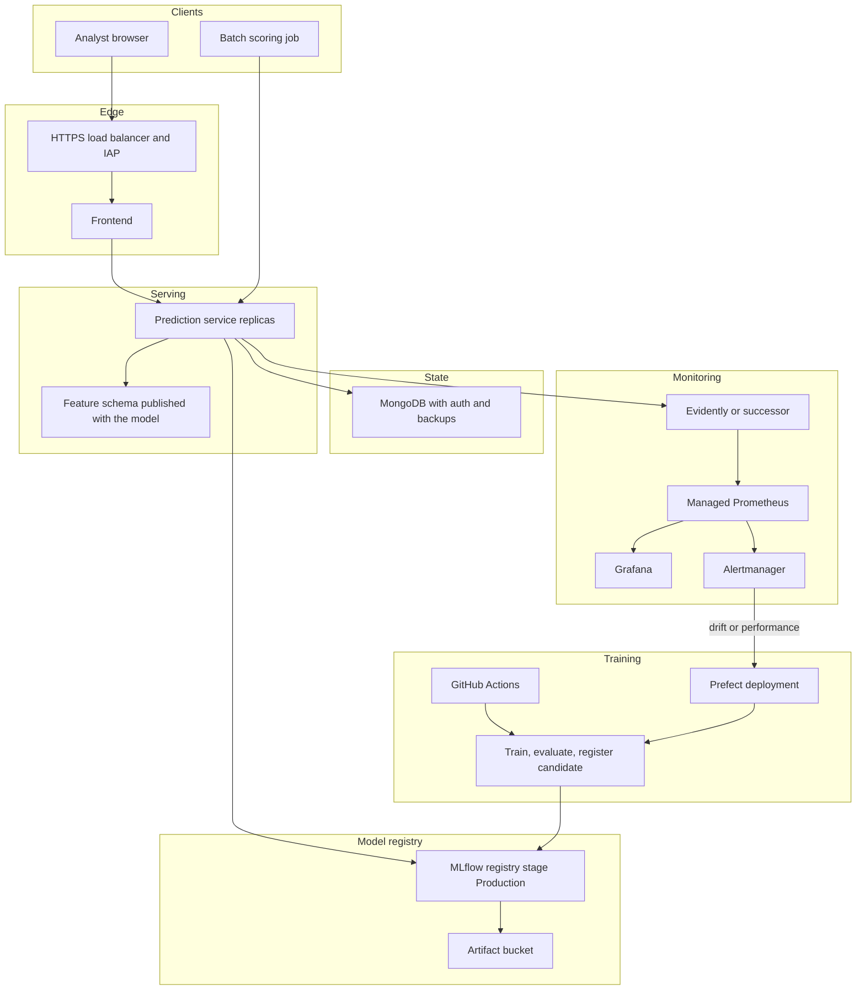

# Productionizing this stack

The Compose file runs the demo on one machine. A production deployment has to promote models on purpose, keep the feature contract in one place, protect the API, and page a person when drift shows up. This document is the punch list, then the layout to aim for.

Do not point this model at real allocation decisions. It was trained on the 1994 Adult census extract. Relationship and sex are strong stand-ins for household structure in that file, and the saved classifier reflects that. A fairness review, and probably a different feature policy, comes before any use that affects people.

---

## Do these in order

### 1. One versioned model, not two files and a hardcoded run id

Today the service loads `models/clf.bin` plus `models/preprocessor.b`, or, if `MODEL_SOURCE=mlflow`, `runs:/$MODEL_RUN_ID/models_mlflow` from `MLFLOW_TRACKING_URI`. The image still carries the old run id `434e8043496c4d61ae917c1f0ef843ba`. Training code in `B_experimentTracking/train.py` and `C_trainingPipelineOrchestration/orchestration.py` still defaults the tracking URI to `http://10.138.0.5:5000`.

Ship a single MLflow pyfunc (or equivalent) that contains both the DictVectorizer and the classifier. Register it as something like `census-income` and deploy only the version in stage `Production`. The service should read the stage, not a run id baked into the Dockerfile. Keep `MODEL_SOURCE=local` for laptops.

### 2. One feature contract

`frontend/features.py` rebuilds column names such as `education_ Bachelors`, including the leading space left by `get_dummies` on the raw census file. The prediction service trusts whatever JSON it is given. The stream generator builds the same columns a third way.

Put the schema next to the model artifact: field names, allowed categories, numeric ranges, and the education-num map. The form, the API, and any batch job should import or download that schema. Reject unknown categories in the API, not only in the form. Add range checks for age, hours, and the capital fields.

### 3. Replace the Python 3.8 images

`prediction_service/Dockerfile` and `evidently_service/Dockerfile` are Python 3.8, which is end of life. The monitoring image pins Evidently `0.1.51.dev0` because `app.py` imports `evidently.model_monitoring`. That API is gone in current Evidently.

Upgrade the services to a supported Python, pin hashes, and either stay on a maintained Evidently release by rewriting `evidently_service/app.py`, or replace that process with the current Evidently metrics API. Do this before spending time on cluster wiring. The 0.1 pin is installed with `--no-deps` because its PyYAML `~=5.1` requirement does not build cleanly here.

### 4. CI that builds the same Compose stack

There is no GitHub Actions workflow. Add one that:

1. Runs `pytest tests/test_applicant_features.py tests/test_prediction_api.py`.
2. Builds `docker compose build`.
3. Starts the stack, waits for `GET /health` on port 9696 and `GET /_stcore/health` on port 8501, posts the part-time and manager payloads, and checks the income class.
4. Scans the images.

`Makefile` `quality_checks` still runs isort, black, and pylint across the whole tree. The older notebooks-era modules will fail that until they are cleaned up. Do not pretend `make build` is green until that is fixed or the hook is scoped to the serving code.

### 5. Auth and a private network

Nothing in Compose authenticates callers. Grafana is `admin` / `admin` on purpose for local use. Mongo has no user. The prediction port is published on the host.

In production:

- Put the form and the API behind HTTPS.
- Require identity on the form (SSO or Identity-Aware Proxy) and a service credential on `POST /predict`.
- Do not publish Mongo, Prometheus, or Evidently on a public interface.
- Rotate the Grafana admin password and disable anonymous access. The signup flag is already off in Compose.
- Store `MODEL_RUN_ID`, tracking URIs, and database URLs in a secret manager. Do not commit the next `.env`.

### 6. Alerts that reach a person

`evidently_service/config/prometheus.yml` used to list an Alertmanager at `alertmanager:9093` and a rules file that was not in the repo. Prometheus would not start. The local file now mounts `alert.rules` with an empty `groups` list, and the Alertmanager block is gone so the demo boots.

Add rules that matter for this model, for example:

- Evidently data-drift share above a threshold for 15 minutes.
- Prediction error rate or latency above a threshold.
- No successful scores for a stretch of time when traffic is expected.
- The share of `income_class = 1` moving far from the training base rate.

Send them to Alertmanager, then to the channel the on-call already uses. A chart nobody watches is not monitoring.

### 7. A retrain trigger, not a dashboard glance

The Prefect flow in `C_trainingPipelineOrchestration/orchestration.py` can train. Nothing connects it to Evidently. When a drift or performance alert fires, Alertmanager should call a Prefect deployment webhook (or a small worker) that starts that flow against a fresh extract, registers the candidate, and leaves promotion to a person or a gated check. Do not auto-promote the first run that beats the old F1.

### 8. Reference data and the monthly extract

The file under `evidently_service/datasets/` is 1,200 sampled rows so local drift has something to compare against. Production reference data should be the full training matrix for the promoted model, stored in object storage, and loaded by the monitoring service at startup. When a new model is promoted, the reference object changes with it.

The README's original note still stands: a monthly census-style extract needs a real ingestion job. `A_exploratoryAnalysis/data-process.py` is a one-shot split, not that job.

### 9. Prediction history you can trust

Scores go to MongoDB database `prediction-service`, collection `data`, with `predicted_at` and `probability_over_50k`. For production, turn on auth, backups, and a retention policy. The history endpoint is unauthenticated and returns the raw feature row. Treat that as personal data even in a demo, and do not log full payloads in access logs.

### 10. Run more than one copy

The prediction container is a single gunicorn process with no CPU or memory limit. Put at least two replicas behind a load balancer, set requests and limits, and keep the model load on startup (it already happens at import). The frontend can be a separate static or Streamlit deployment that only knows the API URL. Healthchecks already hit `GET /health`.

### 11. Point the stream generator at the service you mean

`stream-generator/send_data.py` posts to `http://10.138.0.5:9696/predict`. Change that to configuration before using it as a load generator. It also depends on `../data/adult-test.csv`, which is not in git.

---

## Target architecture

This is the GCP-shaped version of the same pieces, because the training code already speaks MLflow, GCS-style artifact paths, and Prefect. The boundaries are the same on another cloud. The important part is that training, promotion, serving, and alerting are separate, and only a promoted model reaches the API.

### What moves where

| Local Compose | Production replacement |
| --- | --- |
| Streamlit on port 8501 | Frontend behind HTTPS and login. It only calls the API. |
| `clf.bin` in the image | Model pulled by registry stage at startup. Image builds do not bake a champion model. |
| `features.py` column names | Schema artifact versioned with the model. API rejects mismatches. |
| Mongo with no auth on port 27018 | Managed Mongo, private network, backups, retention. |
| Evidently 0.1 sample CSV | Reference parquet for the promoted model in object storage. |
| Prometheus plus empty rules | Managed Prometheus, real rules, Alertmanager, an on-call route. |
| Grafana `admin` / `admin` | SSO, no default password, dashboards as code. |
| Prefect flow you start by hand | Deployment triggered by schedule and by drift alerts. Promotion stays gated. |
| No CI | GitHub Actions builds, tests, and a smoke prediction before deploy. |

### Promotion path

1. Prefect trains a candidate and logs metrics plus the packaged preprocessor and classifier.
2. CI or a reviewer compares F1, calibration, and a slice check against the current Production model.
3. A person or a protected job moves the candidate to `Production`.
4. Serving rolls forward, reads the new Production version, and Evidently swaps in the matching reference file.
5. Alertmanager watches the new version's drift and score mix. A failed check rolls the registry stage back and restarts the service on the previous version.

That last step is the one this repo cannot do yet. Everything above is here so the next change has a place to land.
