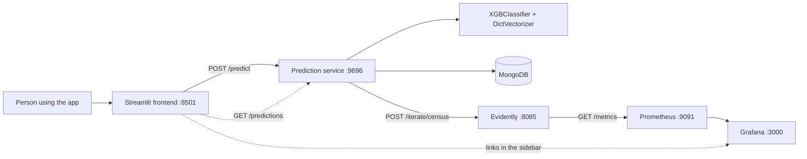
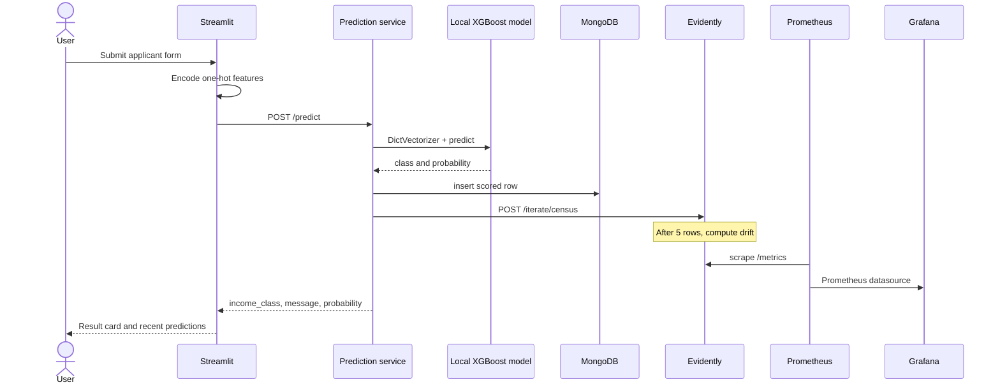
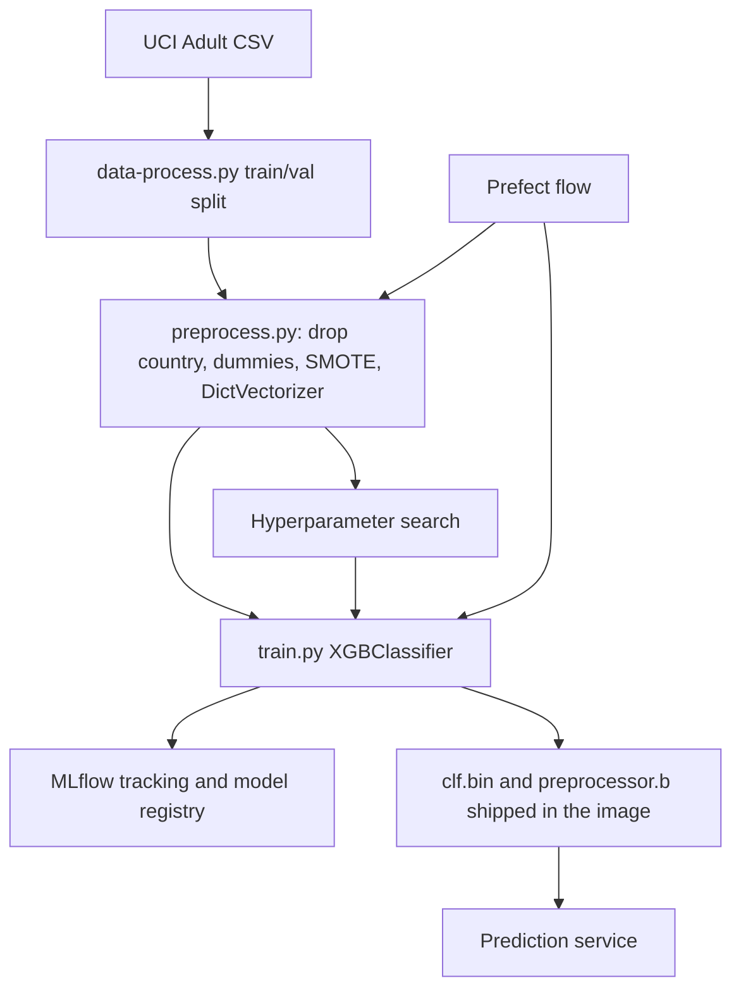

<p align="center"></p>

# Income Prediction Pipeline

A small MLOps system that guesses one thing: does this person earn more than $50,000 a year?

You type in an applicant. A web app sends those details to a prediction service. An XGBoost model, trained on the 1994 US Census Adult dataset, answers **over $50k** or **$50k or under**, with a probability. Every score is stored, and Evidently, Prometheus, and Grafana watch the traffic for drift.

This is a demo stack. The census categories are from 1994, and the model is not something to use for real decisions about people.

---

## Run the whole stack with Docker

You need Docker with the Compose plugin (`docker compose`).

From the repository root:

```bash
docker compose up --build
```

The first build is the slow one. The prediction image installs its Pipenv lock, and the monitoring image installs the Evidently 0.1 stack. Later starts are quicker.

When the containers are up, open:

| What | URL | Notes |
| --- | --- | --- |
| Prediction app | http://localhost:8501 | Enter an applicant and get a score |
| Prediction API | http://localhost:9696/health | Flask + gunicorn |
| Grafana | http://localhost:3000 | Login `admin` / `admin` |
| Prometheus | http://localhost:9091 | Scrapes Evidently |
| Evidently metrics | http://localhost:8085/metrics | Prometheus text format |
| MongoDB | `localhost:27018` | Database `prediction-service`, collection `data` |

Stop it with `Ctrl+C`, or `docker compose down` from another shell. Add `-v` if you also want to drop the Mongo, Prometheus, and Grafana volumes.

`make up` is the same command.

### Try a prediction

1. Open http://localhost:8501.
2. Leave the part-time example loaded, or choose **Example: experienced manager** and click **Load example**.
3. Click **Predict income**.
4. The card shows the band, the sentence returned by the API, and the probability of income over $50,000.
5. Scroll down for the newest scores. The sidebar links to Grafana, Prometheus, and the Evidently metrics endpoint.

The part-time example scores in the lower band. The experienced-manager example scores in the higher band. Those two fixtures are also what `tests/test_prediction_api.py` checks.

### Demo

Walk the app and the monitoring links in one pass. Drift panels stay empty until Evidently has seen five scores, so predict a few times before you open Grafana. The monitor keeps a window of the last five calls.

1. Open http://localhost:8501. The sidebar is the map: **Grafana dashboards**, **Prometheus targets**, and **Evidently metrics**. The green line means `GET /health` on the prediction service succeeded.
2. Choose **Example: experienced manager**, click **Load example**, then **Predict income**. The card should read over $50,000, with a probability near 78%.
3. Scroll to **Recent predictions**. The newest row is that call. It was stored in MongoDB.
4. Open Grafana at http://localhost:3000 and sign in as `admin` / `admin`. Open **Evidently Data Drift Dashboard** and set `dataset_name` to `census`. You should see a drifted-feature count, not an empty panel. This URL opens that view directly: http://localhost:3000/d/U54hsxv7k/evidently-data-drift-dashboard?orgId=1&var-dataset_name=census
5. Open http://localhost:9091/targets. The `service` job should be up. That is Prometheus scraping Evidently.
6. Open http://localhost:8085/metrics and look for lines that start with `evidently:data_drift`. Same numbers, as text.

Live requests do not include the true income label, so this Compose stack calculates feature drift only. Charts that need a ground-truth label are left for a batch job that joins scores back to labels. That split is in `PRODUCTIONIZING.md`.

### Run the web app on its own

Useful if the API is already running on your machine:

```bash
pip install -r frontend/requirements.txt
PREDICTION_SERVICE_URL=http://127.0.0.1:9696 streamlit run frontend/app.py
```

### Tests that do not need Docker

```bash
pip install flask pymongo requests scikit-learn xgboost mlflow pytest
pytest tests/test_applicant_features.py tests/test_prediction_api.py
```

`pytest tests/` also collects `tests/test_data_process.py`. That file skips unless the original Adult CSVs are present at the paths baked into it.

---

## What you are looking at



The browser only talks to Streamlit. Streamlit calls the prediction service over the Compose network. Grafana links in the sidebar are for your browser, so they use `localhost` and the published ports.

---

## How a score is made

The form collects normal fields: age, education, occupation, hours, and so on. The model does not. Training ran `pandas.get_dummies` on the raw census file, and those values have a leading space (` Private`, ` Bachelors`). The resulting columns look like this:

```text
education_ Bachelors
workClass_ Private
occupation_ Exec-managerial
```

That space after the underscore is part of the feature name. `frontend/features.py` is the only place the form builds those keys. It also fills `educationNum` from the selected education, using the UCI Adult scale from 1 (preschool) to 16 (doctorate).

`nativeCountry` is not sent. `preprocess.py` drops it before fitting the vectorizer.

The prediction service then:

1. Casts numeric fields to floats, so a string age is not silently scored as zero.
2. Runs the DictVectorizer in `prediction_service/models/preprocessor.b`.
3. Scores `prediction_service/models/clf.bin`.
4. Returns `income_class` (`0.0` or `1.0`), a short message, `probability_over_50k`, and `model_version`.
5. Writes the row to Mongo and forwards a copy to Evidently.

If Mongo or Evidently is down, the score still comes back. The history panel says so when the database cannot be read. Check `GET /health` and `GET /predictions?limit=20` if you want the API without the form.

To call it yourself:

```bash
curl -s http://localhost:9696/predict \
  -H 'Content-Type: application/json' \
  -d '{"age":22,"financialWeight":200000,"educationNum":9,"capitalGain":0,"capitalLoss":0,"hoursPerWeek":20,"education_ HS-grad":1,"maritalStatus_ Never-married":1,"occupation_ Other-service":1,"relationship_ Own-child":1,"race_ White":1,"sex_ Female":1,"workClass_ Private":1}'
```

---

## Serving and monitoring



Evidently's reference set is `evidently_service/datasets/adult-train.csv`. It is a stratified sample of the UCI Adult training file: 600 rows from each income class, `random_state=12`, with the original column names and the leading spaces intact. It is there so monitoring starts without a private data drop. It is not the full training set.

Prometheus scrapes `evidently_service:8085` every 10 seconds. Grafana reads Prometheus at `http://prometheus:9090` inside the Compose network and is published on port 3000. An empty `alert.rules` file is mounted so Prometheus can boot. Nothing pages you yet. That is called out in `PRODUCTIONIZING.md`.

The local monitor is data drift. A score does not come with the true label, so classification-performance charts are not run here. Rare census categories that never appear in the reference sample are filled with zero so Evidently can still index the full column list. The [Demo](#demo) section is the click path.

---

## How this project is put together

The folders follow the order the system was built.

### 1. Data preparation — `A_exploratoryAnalysis/`

`data-process.py` names the census columns and writes a train/validation split. The raw Adult file is not in git (`data/` is ignored). Columns are `age`, `workClass`, `financialWeight`, `education`, `educationNum`, `maritalStatus`, `occupation`, `relationship`, `race`, `sex`, `capitalGain`, `capitalLoss`, `hoursPerWeek`, `nativeCountry`, and `incomeTarget`.

The exploratory notebook compared class balance and model families. The label is imbalanced: most people in the file are at or under $50k. SMOTE is applied later, during preprocessing, to upsample the smaller class. XGBoost was chosen over logistic regression, gradient boosting, and a random forest.

### 2. Features and training — `B_experimentTracking/`

`preprocess.py` drops `nativeCountry`, turns the income label into 0/1, one-hot encodes with `get_dummies`, upsamples with SMOTE, and fits a `DictVectorizer`.

`train.py` fits an `XGBClassifier` (`n_estimators=100`, `learning_rate=0.1`, `max_depth=3`) and logs the model to MLflow under the artifact path `models_mlflow`. `hpopt.py` and `register_model.py` are the hyperparameter search and registry steps. The notebooks in this folder are the lab trail.

The Docker prediction service does not need that MLflow server. It loads the pickled classifier and vectorizer that were saved from a training run:

- `prediction_service/models/clf.bin`
- `prediction_service/models/preprocessor.b`

Set `MODEL_SOURCE=mlflow` when you do have a tracking server. Also set `MLFLOW_TRACKING_URI` and `MODEL_RUN_ID`. The historical run id still set in the image is `434e8043496c4d61ae917c1f0ef843ba`. It only resolves if that server still has the run.

### 3. Orchestration — `C_trainingPipelineOrchestration/`

`orchestration.py` is a Prefect flow that repeats the same read, preprocess, search, and train steps. The original project ran Prefect Orion on one GCP VM and MLflow on another, with artifacts in a Cloud Storage bucket. Those VM addresses were specific to that project and are not part of the local stack. Point `MLFLOW_TRACKING_URI` and `PREFECT_API_URL` at whatever you deploy.



### 4. Prediction service — `prediction_service/`

Flask app in `predict.py`, served by gunicorn on port 9696. Routes:

| Method | Path | Purpose |
| --- | --- | --- |
| `GET` | `/health` | Liveness and model version |
| `POST` | `/predict` | Score one JSON object |
| `GET` | `/predictions` | Newest stored scores, up to 100 |

`MODEL_SOURCE=local` is the default in `docker-compose.yml` and in the image. Mongo writes and Evidently posts are attempted after every score and do not fail the response.

### 5. Monitoring — `evidently_service/`

`app.py` loads the reference sample when the process starts, accepts batches on `POST /iterate/<dataset>`, and exposes Prometheus metrics on `/metrics`. The dataset name the prediction service uses is `census`. Column lists in `config.yaml` match the one-hot names from training.

Prometheus and Grafana config live under `evidently_service/config/`. Dashboards live under `evidently_service/dashboards/`.

### 6. The form — `frontend/`

Streamlit app. `features.py` holds the category lists, the two examples, and the encode/decode functions. `app.py` is the page. The category labels on screen are friendly. The values sent to the model are the census codes.

### 7. A traffic generator — `stream-generator/`

`send_data.py` replays rows at a prediction URL. It still targets the old host `10.138.0.5`. For a local replay, point it at `http://localhost:9696/predict`. It expects the Adult CSV and sends already-encoded rows, which is the same shape `/predict` accepts.

---

## Compose services

```text
frontend            8501  Streamlit
prediction_service  9696  depends on Evidently and Mongo, healthcheck on /health
evidently_service   8085  reference CSV mounted at /app/datasets
prometheus          9091  container port 9090
grafana             3000  admin / admin
mongo               27018 container port 27017
```

`frontend` waits until the prediction healthcheck passes, then starts. The prediction service can score even if the first Evidently call times out while the reference sample is still loading.

Service hostnames inside Compose are `prediction_service`, `evidently_service`, `mongo`, `prometheus`, and `grafana`. Do not add a trailing dot. Docker DNS will not resolve an absolute name like `mongo.`.

---

## Project layout

```text
frontend/                         Streamlit app and feature encoding
prediction_service/               Flask API, Dockerfile, saved model
evidently_service/                Drift service, Prometheus, Grafana
stream-generator/                 Optional row replay
A_exploratoryAnalysis/            Column names and the split script
B_experimentTracking/             Preprocess, train, registry
C_trainingPipelineOrchestration/  Prefect flow
tests/                            Encoding tests and API tests
docker-compose.yml                Full local stack
PRODUCTIONIZING.md                What to do before this is a real deployment
```

---

## Where to go next

Local Docker is a demo, not a deployment. `PRODUCTIONIZING.md` lists the concrete follow-ups: a real model registry, auth, alerts, a retrain loop, and a production layout diagram.
